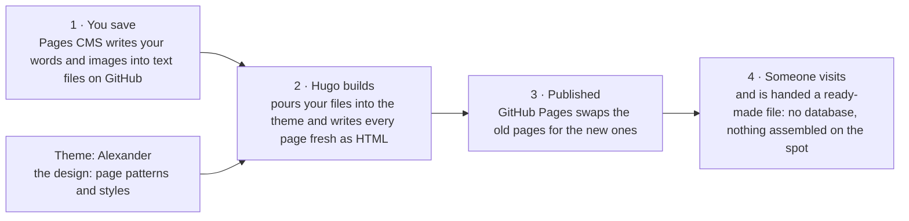

# How Hugo Works: A Quick Explainer

21 Nov 2026 · Garrison LeMasters

Hugo is a *static site generator*: it takes your text files and a design, and writes out a finished set of ordinary web pages. There is no database and no program running behind your site. Every time you save, Hugo rebuilds every page from scratch, and the new pages replace the old ones.

In this class the design is **Alexander**, a theme written for the department. It reads your Markdown files, lays out your projects by how many you have, and makes smaller copies of your images for phones. The forms you fill in through Pages CMS are Alexander's forms.

## From save to page

Every save rebuilds the whole site; visitors only receive finished files.

Steps 1 to 3 take one to two minutes. They repeat in full after every save.

Hugo is the only step that does any work, and it does it before anyone visits. By the time a reader arrives, your portfolio is just a set of finished files waiting to be handed over.

## Hugo vs. a database site

A site like WordPress builds each page *when someone asks for it*; Hugo builds every page *once, in advance*. Think of a printed edition versus a live performance: Hugo prints the whole edition each time you revise, and visitors read copies.

|  | Database site (e.g. WordPress) | Hugo site (your portfolio) |
| --- | --- | --- |
| Where your words live | Rows in a database | Text files in your GitHub repository |
| When a page is made | Every time someone visits | Once, each time you save |
| What the server does | Runs a program, queries the database, assembles the page | Hands over a file that already exists |
| What a visitor receives | A freshly assembled page | A ready-made HTML file |
| Things that can break | Database, plugins, server program, updates | Almost nothing once published |
| Hosting | Needs a server that runs programs | Any file host; GitHub Pages is free |

## What this means for you

- **Changes take a minute or two.** Your edit isn't live until Hugo has rebuilt the site and GitHub has published it. Watch the **Actions** tab if you're curious.
- **The whole site is rebuilt every time,** even for a one-word change. That is normal: Hugo also resizes your images each time, which takes a few seconds more.
- **Fast and free.** Serving finished files is the cheapest, quickest thing a web host can do, which is why GitHub Pages costs nothing.
- **Every save is kept.** Your files live in GitHub, which records each change. A mistake can be undone by going back to an earlier version.
- **Nothing runs on the page's server.** Features that need to remember things between visits (contact forms that store messages, comments, visitor counters, logins) have to come from an outside service. Alexander's Analytics form connects one for visitor counts.
- **A failed build is harmless.** If something in your files stops Hugo from building, the previous version of your site stays up until the problem is fixed.

## Words you'll see

| Term | Meaning |
| --- | --- |
| Static site | A site made of finished files, the same for every visitor |
| Repository (repo) | Your project's folder on GitHub, with a history of every change |
| Commit | One saved change in that history; each Pages CMS save is a commit |
| Content files | Your words and settings, in plain text (`.md` and `.yaml` files) |
| Theme / template | The design: the HTML patterns Hugo pours your content into. Yours is Alexander |
| Build | Hugo's run that turns content plus theme into HTML pages |
| Workflow / Actions | GitHub's automatic routine that runs the build after each commit |
| Deploy / publish | Putting the newly built pages online |
